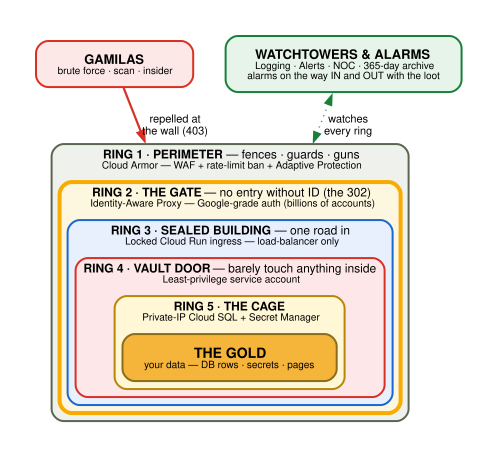
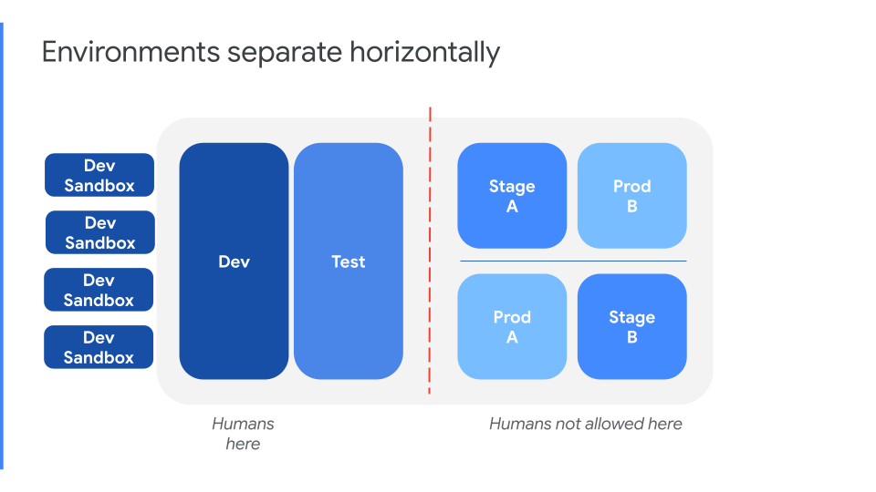
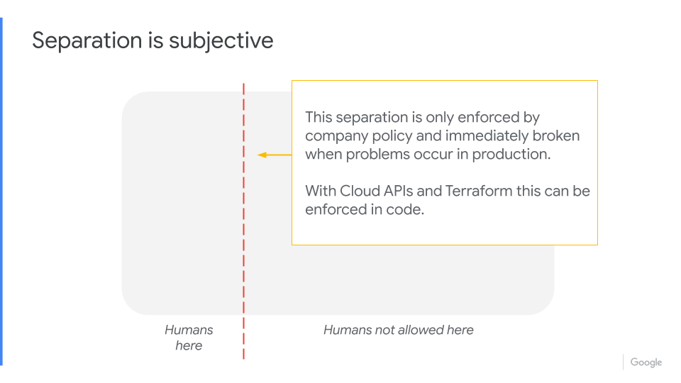
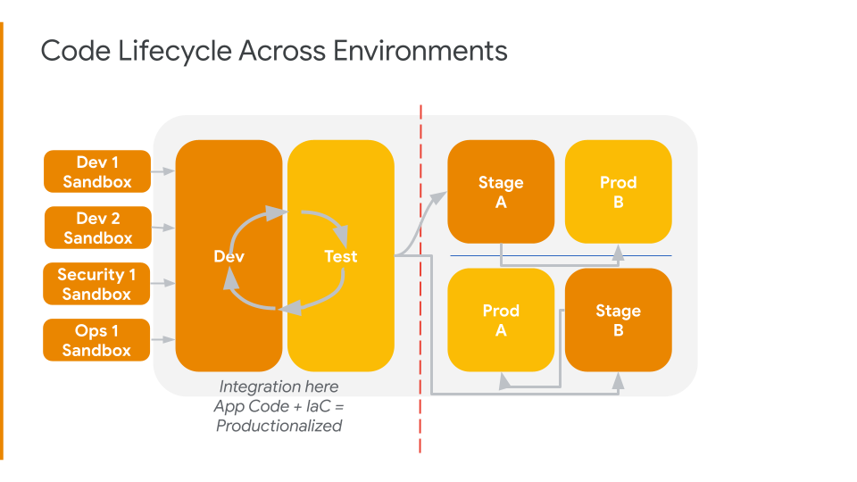
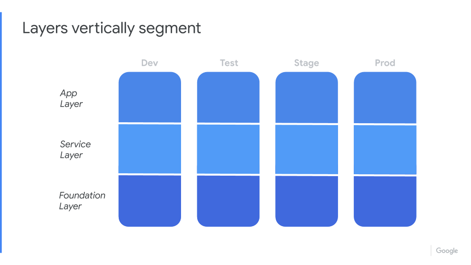

# SMC Infrastructure State

SimplifyMy.Cloud infrastructure state with a focus on simplicity and empathy.

Built with the [Terraform Google provider](https://registry.terraform.io/providers/hashicorp/google/latest/docs).

---

## 🧭 Start here: the live GCP Org

**[`foundation/readme.md`](foundation/readme.md)** is the one-hour guide for a new SRE. It covers the Org tree, the networking whiteboard, who runs Terraform, and the security findings. In one line:

> **GCP = git = Terraform state.** Every Org / folder / project node has one git directory under `foundation/`, and that directory's state lives at the same path in `gs://smc-ops-tf-state/terraform/state/`. All of it was imported from the live Org (2026-11-01/02), hardened on 2026-11-02, and plans to `No changes`. Terraform runs as a plan-only service account; changes are applied in short, git-recorded change windows.

```
foundation/
├── gcp-org/                 org policies
├── gcp-folders/<env>/       smc-ops · smc-dev · smc-prod
├── gcp-projects/<env>/<p>/  each project + every in-project service
├── iam/…                    org / folder / project IAM, SAs, custom roles
├── logging/…                org / folder / project sinks + log buckets
├── networks/<env>/<p>/      VPCs and subnets
├── firewalls/<env>/<p>/     firewall rules
└── gce-bakery/              Packer image recipes
gcp_provider.tf              the ONE shared provider file, symlinked into every Terraform dir
```

Repo layout: [`foundation/`](foundation/) (live) · [`service/`](service/) (no apps deployed today) · [`app/`](app/), [`redteam/`](redteam/), [`Bootstrap/`](Bootstrap/) (iq9-era, historical) · [`docs/`](docs/).

Every directory has a `readme.md`, with one exception: [`.github/`](.github/) uses [`about.md`](.github/about.md). GitHub shows a README in `.github/` as the repo's front page in place of this file, so that folder must not have one.

---

## 🔐 Security Checklist Handbook

_(iq9-era: written for the retired iq9 demo estate; the principles still apply.)_ The **[Security Checklist Handbook](docs/security/)** is the Fort Knox playbook for this
platform — the layered defenses (Cloud Armor → IAP → locked ingress → least-privilege →
private data → org policy → full logging), the zero-trust/IAP model, the red-team demo
playbook, and a business-ready **[Fort Knox pitch](docs/security/fort-knox.md)** with diagram.



---

## Traditional horizontal environments



A traditional environment segmentation that everyone should be using now is the classic Dev - Test - Prod.

_Today the Org has three folders: `smc-ops`, `smc-dev` and `smc-prod`. Sandbox, test and stage, used below, are the target model and don't exist yet._

From what we have seen engaging with customers on their infrastructures is humans are everywhere, bringing technical debt, toil, and destruction to everything they type or click.

The main goal for achieving a healthy infrastructure state is to remove the humans from production and keep them in the dev environment where they must have any and all permissions to get their job done.

## Humans in sandbox - No humans in prod



Using Cloud APIs + Terraform, we can give humans `RO - Read Only` access to production, preventing unknown or unwanted desired state changes to production.  While we are preventing changes to production that are outside of Infrastructure-as-Code, we _must allow engineers to be successful_ by giving them `RW - Read Write`, any and all access needed in the sandbox and development environment, so they can do their job and go home feeling successful.

_Today this isn't enforced yet: `chris@` still holds direct grants at org, folder and project level (finding #8 in [`foundation/readme.md`](foundation/readme.md))._

## WebUI & CLI welcome in sandbox

Because the Foundation Layer "locks" the base of GCP and prevents unknown or unwanted outside access from the public internet, the developers are freed up to do with their sandbox environments as they please.  We want to empower developers to be mad scientists in a laboratory free to explore solutions to problems or add value to customers.  That means we do not need or want to slow down developers with Terraform code to use their personal sandbox environments.  Devs are free to use the WebUI Console, the GCP API, the CLI, the SDK, whatever empowers them to be creative.  However, at some point, before the code created in the sandbox environment is able to be shipped out and over into the development environment it must be Terraform'd by someone.

## Environment promotion of code



1. Code genesis in the personal developers sandbox
2. Code promoted to development environment for integration with other app code and Terraform infrastructure state code
3. Code promoted to testing environment for automated security, performance, and infrastructure testing
4. Code promoted to staging environment for 10% migration of production customer traffic along with testing passes by human test team
5. Code fully promoted to production


## Infrastructure Layers



Breaking apart the cloud into three vertical layers delivers a simple infrastructure state to manage and push changes to.  The goal of a well defined and engineered infrastructure is a DevOps culture which promotes healthy collaboration between all customers of that infrastructure, development, operations, security, end users and management.

Infrastructure empathy is the foundation on which this is engineered.  Empathy for developers so they will never worry about making accidental changes to Production, empathy for operations by incorporating self-healing and self-sizing along with self-service for other teams, empathy for the security folks by siloing environments and access into auditable and verifiable worlds.

## Foundation Layer

The Foundation Layer is responsible for ensuring the state of:

* GCP Organization
* GCP Folders
* GCP Projects
* Security
* Networking
* IAM


## Service Layer

The Service Layer is responsible for:

* GCP cloud native services
  * GKE
  * GCS
  * BigQuery
  * CloudSQL
  * Cloud Run
  * etc...
* GCE VMs
  * _must be "baked" in the GCP Bakery to be available on the GCP API_

## App Layer

The App Layer is the orchestration of applications deployed and running on the Service Layer services.  The App Layer _should not be_ managed in Terraform! There are better solutions for managing App state: Ansible, Jenkins, Spinnaker, etc.

App Layer hosts:

* Containers
* Helm Charts
* Binaries
