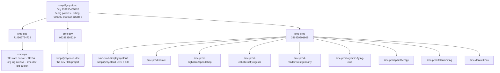

<!-- hand-written -->
# Foundation Layer

The Terraform that describes the **simplifymy.cloud GCP Org exactly as it is**. Every org policy, folder, project, API, bucket, DNS record, Firebase app, IAM grant, log sink, VPC and firewall rule in the Org was imported here on **2026-11-01/02**, and every directory plans to **`No changes`**.

Values are **hardcoded**: no variables, no modules. Foundation changes rarely, and anyone reading a file should see exactly what is in GCP without chasing inputs.

> **New SRE? Read this page, then [`gcp-org/`](gcp-org/), [`gcp-folders/`](gcp-folders/), one project end to end (start with [`gcp-projects/smc-ops/smc-ops/`](gcp-projects/smc-ops/smc-ops/)), and [`networks/`](networks/) + [`firewalls/`](firewalls/).** After about an hour you should be able to whiteboard the two diagrams below from memory.

---

## 1. The three mirrors: GCP = git = Terraform state

The whole design rests on one rule: **every node in the GCP resource tree has exactly one git directory, and that directory's Terraform state lives at the same path in GCS.**

```
GCP                              git (this repo)                                  Terraform state (GCS)
─────────────────────────────    ───────────────────────────────────────────────  ─────────────────────────────────────────────────────────────
Org simplifymy.cloud          →  foundation/gcp-org/                            →  gs://smc-ops-tf-state/terraform/state/foundation/gcp-org/
 └ folder smc-prod            →  foundation/gcp-folders/smc-prod/               →  …/foundation/gcp-folders/smc-prod/
    └ project smc-prod-bbmrc  →  foundation/gcp-projects/smc-prod/smc-prod-bbmrc/ → …/foundation/gcp-projects/smc-prod/smc-prod-bbmrc/
```

So:

- To find the code for a GCP thing, walk the same path in git.
- To find the state for a git directory, put `gs://smc-ops-tf-state/terraform/state/` in front of its path.
- One directory is one state file, which means one blast radius. Changing a firewall in one prod project can never touch another project.

The same project shows up in several **slices**, one per concern, so each state stays small and each review stays focused:

| Slice | Owns | Path pattern |
| --- | --- | --- |
| [`gcp-org/`](gcp-org/) | org policies | `gcp-org/` |
| [`gcp-folders/`](gcp-folders/) | the 3 environment folders | `gcp-folders/<env>/` |
| [`gcp-projects/`](gcp-projects/) | each project + every in-project service (APIs, GCS, DNS, Firebase, App Engine, KMS, BigQuery, monitoring, ...) | `gcp-projects/<env>/<project>/` |
| [`iam/`](iam/) | IAM grants, custom roles, service accounts, audit config | `iam/gcp-org/`, `iam/<env>/`, `iam/<env>/<project>/` |
| [`logging/`](logging/) | log sinks and log buckets | `logging/gcp-org/`, `logging/<env>/`, `logging/<env>/<project>/` |
| [`networks/`](networks/) | VPCs, subnets, routers | `networks/<env>/<project>/` |
| [`firewalls/`](firewalls/) | VPC firewall rules, Cloud Armor | `firewalls/<env>/<project>/` |
| [`gce-bakery/`](gce-bakery/) | Packer image recipes (no Terraform state) | — |

A project with nothing in a slice (no VPC, say) has no directory in that slice.

---

## 2. Whiteboard #1 — the Org



| Folder | Purpose | Projects |
| --- | --- | --- |
| **smc-ops** | SRE / platform: Terraform state, Terraform identities, central logs | `smc-ops` |
| **smc-dev** | development and experiments | `simplifymycloud-dev` |
| **smc-prod** | customer and company production sites (mostly Firebase + App Engine) | 8 × `smc-prod-*`, `smc-dental-knox` |

**Org policies** (enforced at the top and inherited everywhere; no folder or project overrides them): `iam.disableServiceAccountKeyCreation`, `compute.requireOsLogin`, `compute.managed.requireOsLogin`, `compute.skipDefaultNetworkCreation`, `compute.restrictXpnProjectLienRemoval`.

**Billing:** every project is on `000000-000002-6D3BF8` (simplifymycloud-billing-main).

---

## 3. Whiteboard #2 — networking

The networking picture is deliberately simple to draw, because today there is very little of it:

```
                    ┌──────────────── Internet ────────────────┐
                    │                                           │
   6 projects, each with its OWN auto-mode "default" VPC — no Shared VPC, no peering, no VPN/Interconnect
   ┌───────────────────────────┐   ┌──────────────────────────────────────────────────────────┐
   │ simplifymycloud-dev       │   │ smc-prod-simplifymycloud · -bigbarkozspeedshop ·          │
   │ default (auto, REGIONAL)  │   │ -caballerosflyingclub · -madeinwestgermany · -trilliumhiring│
   │ + gitlab-lb-test-01-sub   │   │ default (auto, REGIONAL) — one /20 per region             │
   │   10.0.0.0/24 us-west1    │   │ fw: default-allow-icmp from 0.0.0.0/0 (no SSH/RDP)        │
   │ fw: http/https public,    │   │     default-allow-internal 10.128.0.0/9                    │
   │     ssh via iap-22 only,  │   │                                                          │
   │     health checks         │   └──────────────────────────────────────────────────────────┘
   └───────────────────────────┘
   No VPC at all: smc-ops, smc-prod-bbmrc, smc-prod-olympic-flying-club, smc-prod-psmtherapy, smc-dental-knox
```

- **Auto-mode `default` VPCs** come with one subnet per GCP region (`10.128.0.0/9` split into /20s). Those auto subnets and their routes belong to the network, so they are **not** separate Terraform resources. Only the one custom subnet (`gitlab-lb-test-01-sub`) is.
- **No VPC talks to another one.** Every network is an island, and traffic between projects goes over the internet or Google APIs.
- New projects get **no** default VPC (`compute.skipDefaultNetworkCreation`). The six that have one predate that policy.
- The prod sites serve traffic through **Firebase Hosting / App Engine**, not through these VPCs. The VPCs exist mostly because they were auto-created.

---

## 4. Who runs Terraform

```
chris@simplifymy.cloud ──impersonates──► smc-tf-foundation-sa@smc-ops ──► Terraform ──► GCP
         (roles/iam.serviceAccountTokenCreator,      (identity chosen at RUNTIME via env vars;
          iam/smc-ops/smc-ops/)                       no SA email or key in any *.tf file)
```

```bash
export GOOGLE_IMPERSONATE_SERVICE_ACCOUNT=smc-tf-foundation-sa@smc-ops.iam.gserviceaccount.com
export GOOGLE_BACKEND_IMPERSONATE_SERVICE_ACCOUNT=$GOOGLE_IMPERSONATE_SERVICE_ACCOUNT
cd foundation/<slice>/<path> && terraform init && terraform plan
```

- **One shared file.** The repo-root [`gcp_provider.tf`](../gcp_provider.tf) (Terraform and provider versions, region `us-west1`, `add_terraform_attribution_label = false`) is **symlinked** into every Terraform directory. Change versions there once.
- **One backend file per directory** (`*_gcs_backend.tf`), hardcoded, with the prefix equal to the git path.
- **Quota project = smc-ops.** API calls made *as* the SA are billed to smc-ops, so every Google API that Terraform touches anywhere must be enabled on smc-ops ([`gcp_projects_smc_ops_apis.tf`](gcp-projects/smc-ops/smc-ops/gcp_projects_smc_ops_apis.tf), the `added` list).

### The SA is plan-only; applies happen in change windows

Since 2026-11-02 `smc-tf-foundation-sa` is **read-only** at the Org ([`iam/gcp-org/iam_gcp_org_tf_foundation_sa.tf`](iam/gcp-org/iam_gcp_org_tf_foundation_sa.tf)):

| Grant | Where | Why |
| --- | --- | --- |
| `roles/viewer`, `iam.securityReviewer`, `orgpolicy.policyViewer`, `iam.organizationRoleViewer`, `browser`, `firebaserules.viewer`, `storage.bucketViewer` | Org | `terraform plan` can read every resource and IAM policy. The last two cover reads that `viewer` doesn't: Firebase rulesets, and buckets whose own IAM hides them |
| `roles/storage.objectAdmin` | bucket `smc-ops-tf-state` only ([`iam/smc-ops/smc-ops/`](iam/smc-ops/smc-ops/iam_smc_ops_state_bucket.tf)) | even a plan writes a lock object |

So anyone (or CI) impersonating the SA can `plan` anywhere, but an `apply` fails with permission denied.

**Change windows.** To apply a Foundation change, chris@ opens a window, the SA applies, and chris@ closes the window:

1. In `iam_gcp_org_tf_foundation_sa.tf` set `tf_foundation_sa_write_roles = local.tf_foundation_sa_change_window_roles` (owner, organizationAdmin, orgpolicy.policyAdmin, billing.user, organizationRoleAdmin).
2. Apply `iam/gcp-org` **as chris@**: `unset GOOGLE_IMPERSONATE_SERVICE_ACCOUNT GOOGLE_BACKEND_IMPERSONATE_SERVICE_ACCOUNT`. The SA can't grant itself roles, and if it applied its own role change it could lose organizationAdmin halfway through.
3. Wait about a minute for IAM to take effect, then plan and apply the change as the SA.
4. Set the list back to `toset([])` and apply `iam/gcp-org` as chris@ again. `plan` → `No changes`.

The window's open and close both show up in git and in the Org's audit log.

---

## 5. Making a change

1. Edit the `.tf` in the directory that owns the thing.
2. `terraform plan` in that directory **only**. Expect to see exactly your change.
3. PR → review → apply.
4. `terraform plan` again → `No changes`.

Never change Foundation resources by hand in the Console. The next `plan` will show the drift, and the audit log will show who caused it.

---

## 6. What is in GCP but deliberately **not** in Terraform

Each directory's `readme.md` lists its own; in summary:

| Kind | Why |
| --- | --- |
| Auto-mode subnets and routes | part of the auto-mode `default` network |
| Google-created default SAs (`<n>-compute@developer…`, `<project>@appspot…`) | Google owns them; `google_service_account` can't |
| Google service agents' *existence* (their IAM grants **are** imported) | created by Google when an API is enabled |
| Firestore DBs in 3 projects whose Firestore API is **disabled** | can't be read without turning the API on (a change) |
| SOA records | owned by Cloud DNS |
| Built-in `homepage` dashboards, `goog-ops-agent-*` OS policies, `goog-psc-default` namespace | Google-managed |
| Docker images, Cloud Run revisions, SQL backups, KMS key versions, secret versions, SA keys | data / versions, not configuration |
| `Push-to-any-branch` Cloud Build trigger, a 2018 web-security scan, `tfe-ssl-cert`, Vertex jobs/notebook, a saved query | provider can't express or can't read them (details in `gcp-projects/smc-dev/simplifymycloud-dev/readme.md`) |
| Projects outside the Org (`luminous-figure-442600-b5`, `api-project-691611471390`) | not in the Org |
| `gen-lang-client-0690825234` | to be deleted by hand |

---

## 7. Security findings (imported as-is; fix in later PRs)

The rule for this import was **match GCP exactly**, so known problems were imported unchanged and listed here:

| # | Finding | Where |
| --- | --- | --- |
| 1 | ⏳ Retiring: `smc-ops-tf-org-admin` had org admin and 1 user-managed key. Stage 1 done 2026-11-02 (binding removed, SA and key disabled); stage 2 deletes them on or after 2026-12-02 | [`iam/smc-ops/smc-ops/`](iam/smc-ops/smc-ops/) |
| 2 | ✅ Fixed 2026-11-02: `default-allow-ssh`/`-rdp` (0.0.0.0/0) deleted in 5 prod projects and `smc-fw-public-22` in dev. SSH is IAP-only (dev); a new prod VM's PR must add an IAP-only SSH rule | [`firewalls/`](firewalls/) |
| 3 | ✅ Fixed 2026-11-02: `smc-tf-foundation-sa` is plan-only; write roles only in a change window (section 4) | [`iam/gcp-org/`](iam/gcp-org/) |
| 4 | ✅ Fixed 2026-11-02: `smc-dev-env-logging` retention raised from 3 to 30 days | [`logging/smc-ops/smc-ops/`](logging/smc-ops/smc-ops/) |
| 5 | ✅ Fixed 2026-11-02: org sink `smc-org-log-archive` sends every log to `gs://smc-ops-log-archive` (Archive class, 365 days, not locked) | [`logging/gcp-org/`](logging/gcp-org/) |
| 6 | Firebase "Server key" API keys with **no restrictions** | `gcp-projects/smc-prod/*/` readmes |
| 7 | 43 SA keys exist in the inventory; separate the user-managed ones with `gcloud iam service-accounts keys list --managed-by=user` | `iam/<env>/<project>/` |
| 8 | Direct human grants (`user:chris@` owner/admin roles at org, folder and project level). The "humans out of prod" goal isn't enforced yet | [`iam/`](iam/) |

---

## 8. How this was built

1. A read-only inventory (`gcloud asset search-all-resources` + IAM policies) of the whole Org.
2. For each directory: write `import {}` blocks, then `terraform plan -generate-config-out` so the HCL comes from GCP's real values.
3. Tidy into one file per service, with each import under its resource, and iterate until the plan reads `N to import, 0 to add, 0 to change, 0 to destroy`.
4. Apply (imports only) and re-plan to `No changes`.

The only things created or changed in GCP during the import: the `smc-tf-foundation-sa` SA, the `smc-ops-tf-state` bucket, the SA's org grants and impersonation grant, 33 management APIs on smc-ops, and the **removal** of 10 leftover `iq9-bootstrap-sa` org grants.

**Hardening after the import (2026-11-02).** Each item is a normal plan → apply, and the last three each ran in their own change window, so `git log` shows the open, apply and close commits:

| Change | Finding |
| --- | --- |
| `smc-tf-foundation-sa` made plan-only; change windows introduced | #3 |
| SSH/RDP from 0.0.0.0/0 deleted (5 prod VPCs + dev's `smc-fw-public-22`) | #2 |
| `smc-ops-tf-org-admin` stage 1: org-admin binding removed, SA and its user key disabled | #1 |
| Org-wide log archive sink + bucket; dev log retention 3 → 30 days | #4, #5 |

After each change, all 56 directories re-planned to `No changes`.
